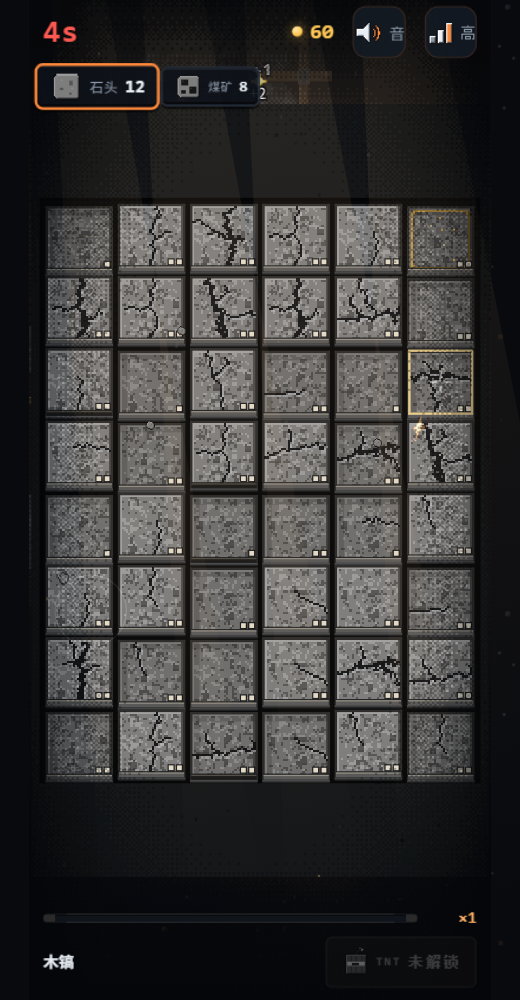
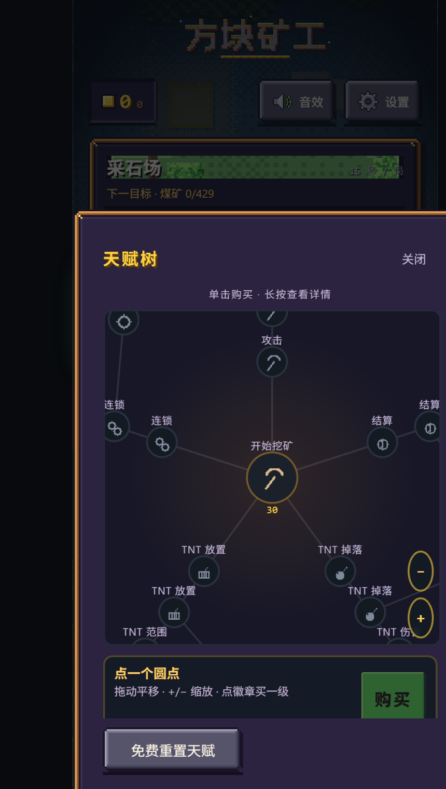

# 方块矿工 · Block Miner

一个**单文件、零依赖、离线可玩**的像素挖矿小游戏。挖方块、掉金币、点天赋、炸个不停。

> 打包后只有一个 `index.html`（约 1.5 MB），所有 JS / CSS / 图片全部内联，音效由 WebAudio 实时合成——**没有任何网络请求**。

## 玩法

1. 双击 `index.html`（Chrome / Edge / Safari 均可）。
2. 点「开始挖矿」→ 点方块开挖（按住会自动连发）→ 结算金币 → 回营地买天赋。
3. 四个大关，一关一种矿：**煤矿层 → 铁矿层 → 金矿层 → 晶石层**，每关解锁一把新工具：木镐 → 铁镐 → 钻石镐（3×3）→ 激光钻（整列贯穿）。
4. 一局约 20 分钟通关。第一关靠**连锁采集**（一镐下去旁边几格跟着碎），第二关起 **TNT 掉落**开始暴增。

## 特色

| 机制 | 说明 |
|---|---|
| **每格多层** | 每块矿是 8–22 层的堆叠，每层独立血量；打穿一层才掉道具 |
| **连锁采集** | 确定性机制：击碎一层时额外摧毁相邻 N 格各一层，N 由天赋决定（1→10 格） |
| **TNT 连锁** | 挖矿有概率掉落 TNT，爆炸再引燃下一颗；后期掉率可达 90% |
| **放射天赋树** | 74 个节点从中心向外发散，单击买一级、长按看详情 |
| **矿层加深** | 999 级无尽长尾天赋：每级让每块矿多一层，想挖多久就挖多久 |
| **处决** | 血量低于阈值时直接击碎该层 |
| **终极目标** | 第四关达成目标后，棋盘中心出现地心宝藏，挖开即通关 |

## 截图

| 矿区 | 天赋树 |
|---|---|
|  |  |

更多截图见 `shots/`。

## 目录

```
index.html          交付物：单文件游戏（build.mjs 生成）
build.mjs           拼接 src/*.js + 内联 style.css + base64 美术资源
src/                11 个模块（配置 / 存档 / 矿区 / 武器 / 掉落 / 粒子 / 音效 / 界面 / 集成）
art/                像素素材 + manifest.json + 生成器（art/_src）
docs/               设计契约、数值平衡、关卡表、美术规格、决策记录
test/               八套自检脚本（node 跑，无需浏览器）
scripts/            验收 / 截图 / 调参辅助脚本
shots/              真机截图
```

## 开发

```bash
# 重新打包（产物是 index.html）
node build.mjs

# 自检（全部用 node 跑，无需浏览器）
node test/core.test.mjs        # 数值 / 经济 / 存档 / 天赋
node test/grid.smoke.mjs       # 矿区 / 分层 / 矿脉
node test/world.smoke.mjs      # 武器 / TNT / 连锁 / 处决
node test/drops.smoke.mjs      # 掉落
node test/fx.smoke.mjs         # 粒子 / 震屏 / 音效注册
node test/ui.smoke.mjs         # 界面 / 天赋树 / 点击链路
node test/integration-v2.mjs   # 全链路
node test/balance.mjs          # 关卡经济结构（辅助）
```

调试 hash：`#demo`（自动挖）、`#frames=N`（确定性快进）、`#diag`、`#tocamp`、`#drawer=talents`、`#noanim`。

## 素材与版权

- 图形由 `art/` 的像素素材 + Canvas 程序化绘制共同构成，**零图片 / 字体 / 音频文件外链**。
- 音效由 WebAudio 实时合成，无音频文件。
- 风格有意贴近方块沙盒观感，但**不使用任何 Minecraft 官方贴图 / 图标 / 字体 / 音效 / 名称**，也未逐像素临摹。
- 不联网、不收集数据，存档仅存于浏览器 localStorage。

## 许可

MIT License，见 [LICENSE](LICENSE)。
